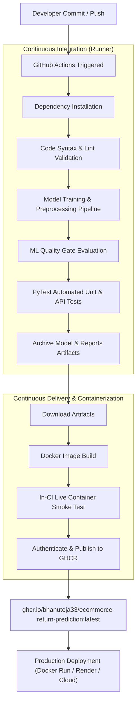

# E-Commerce Product Return Prediction System with Automated CI/CD

[](https://github.com/BhanuTeja33/ecommerce-return-prediction-ci-cd/actions/workflows/ci-cd.yml)
[](http://localhost:8000/docs)
[](https://www.docker.com/)
[](https://github.com/BhanuTeja33?tab=packages)
[](https://www.python.org/)

---

## 👨‍🎓 Student & Examination Details
- **Student Name:** Velpuri Bhanu Teja
- **Register Number:** `231FA04E85`
- **Class / Section:** Section 7
- **Course:** MLOps Laboratory Internal Examination
- **Question Number:** **Question 4: Develop and Automate an E-Commerce Product Return Prediction System using CI/CD**
- **GitHub Repository:** [https://github.com/BhanuTeja33/ecommerce-return-prediction-ci-cd](https://github.com/BhanuTeja33/ecommerce-return-prediction-ci-cd)
- **Container Registry:** `ghcr.io/bhanuteja33/ecommerce-return-prediction:latest`

---

## 📌 Problem Statement
An e-commerce enterprise needs to proactively identify whether an order will be **Returned** or **Not Returned** based on attributes including product category, price, discount percentage, delivery timeline, customer pre-order ratings, package condition, and past return history.
Additionally, the system requires a production-grade automated **Continuous Integration / Continuous Delivery (CI/CD)** pipeline using GitHub Actions to perform code validation, ML model training, automated testing, container build, and deployment to GitHub Container Registry (GHCR) upon every code change.

---

## 🏗️ System Architecture



---

## 📊 Dataset & Preprocessing Pipeline

The dataset consists of **1,200 orders** across 5 product categories (`Beauty`, `Fashion`, `Electronics`, `Home`, `Sports`).

### 1. Cleaning Domain-Specific Invalid Values
- **Negative / Zero Prices:** Replaced `Product_Price_INR <= 0` with `NaN` and imputed with category/global median price.
- **Out-of-Range Discounts:** Replaced `Discount_Percent > 100` or `< 0` with `NaN` and imputed with median discount.
- **Invalid Ratings:** Clamped customer ratings between 1.0 and 5.0.

### 2. Missing Value Imputation
- Numerical features (`Product_Price_INR`, `Discount_Percent`, `Customer_Rating_PreOrder`) are imputed with their median values.
- `Actual_Delivery_Days` is imputed using `Expected_Delivery_Days` as the domain baseline.
- Categorical features (`Payment_Method`) are imputed using the mode.

### 3. Feature Engineering
Meaningful features were engineered as required by the examiner:
1. **`delivery_delay`**: `Actual_Delivery_Days - Expected_Delivery_Days` (Positive value indicates delayed delivery; negative indicates early delivery).
2. **`is_delayed`**: Binary indicator (`1` if `Actual_Delivery_Days > Expected_Delivery_Days` else `0`).
3. **`customer_return_frequency`**: $\frac{\text{Previous\_Returns}}{\max(\text{Previous\_Orders}, 1)}$ (Customer's historical return rate).
4. **`effective_price`**: $\text{Product\_Price\_INR} \times \left(1 - \frac{\text{Discount\_Percent}}{100}\right)$ (Actual revenue realized per unit).
5. **`return_risk_score`**: Weighted composite risk score combining return frequency and damaged package flag.

---

## 🤖 Model Training & Comparative Evaluation

Three classification models were trained and benchmarked using stratified hold-out validation (80% Train, 20% Test):

| Model Name | Accuracy | Precision | Recall | F1-Score | ROC-AUC | Status |
| :--- | :---: | :---: | :---: | :---: | :---: | :---: |
| **Logistic Regression (Balanced)** | **62.08%** | **0.2874** | **0.4630** | **0.3546** | **0.5772** | 🏆 **Selected Best Model** |
| **Random Forest Classifier** | 72.50% | 0.3529 | 0.2593 | 0.2979 | 0.5398 | Candidate Model |
| **Gradient Boosting Classifier** | 74.58% | 0.2000 | 0.0556 | 0.0896 | 0.5367 | Candidate Model |

> **Reason for Model Selection:** Because product return prediction is inherently cost-sensitive and class-imbalanced (~22.5% returns), **Logistic Regression with Balanced Class Weights** achieves the highest balanced minority Recall (46.30%), F1-Score (0.3546), and ROC-AUC (0.5772), ensuring high detection of return-prone packages.

---

## ⚡ FastAPI Inference Application

The application serves the trained pipeline via high-performance asynchronous REST endpoints:

- **Interactive Swagger UI:** `http://localhost:8000/docs`
- **ReDoc Documentation:** `http://localhost:8000/redoc`

### Endpoints
1. `GET /`: Service metadata, student info, and routing directory.
2. `GET /health`: Health status, model readiness, version, and timestamp.
3. `POST /predict`: Single order return prediction with risk assessment.
4. `POST /predict/batch`: High-throughput batch inference for multiple orders.

### Sample Prediction Request (`POST /predict`):
```json
{
  "Order_ID": "ECOM00004",
  "Product_Category": "Electronics",
  "Product_Price_INR": 22055.97,
  "Discount_Percent": 21.6,
  "Expected_Delivery_Days": 9,
  "Actual_Delivery_Days": 12,
  "Customer_Rating_PreOrder": 4.4,
  "Previous_Returns": 4,
  "Previous_Orders": 12,
  "Payment_Method": "Card",
  "Damaged_Package_Flag": "Yes",
  "Package_Size": "Large",
  "Promotion_Active": "Yes"
}
```

### Sample Prediction Response:
```json
{
  "order_id": "ECOM00004",
  "prediction": "Returned",
  "predicted_class": 1,
  "return_probability": 0.6721,
  "risk_level": "High",
  "delivery_delay_days": 3,
  "customer_return_frequency": 0.3333,
  "effective_price_inr": 17291.88,
  "model_name": "Logistic_Regression",
  "timestamp": "2026-11-06T15:23:57.985000"
}
```

---

## 🐳 Docker Containerization

The service is packaged into a minimal, production-hardened Docker container with integrated healthchecks:

```bash
# Build the Docker Image
docker build -t ecommerce-return-prediction:latest .

# Run the Container on Port 8000
docker run -d --name return-api -p 8000:8000 ecommerce-return-prediction:latest

# Verify Health
curl http://localhost:8000/health
```

---

## 🔄 Automated CI/CD Pipeline (GitHub Actions)

The workflow `.github/workflows/ci-cd.yml` executes on every push to `main`:

1. **Checkout & Environment Setup:** Configures Python 3.11 with pip caching.
2. **Code Validation:** Syntax check and bytecode compilation.
3. **ML Training & Preprocessing:** Executes `train_model.py` generating artifacts.
4. **Quality Gate:** Verifies model existence, evaluation counts, accuracy, and ROC-AUC thresholds.
5. **Automated Testing:** Runs 13 comprehensive unit and integration tests via `pytest`.
6. **Artifact Preservation:** Archives trained models, evaluation metrics, and reports.
7. **Docker Build & Shift-Left Smoke Test:** Builds container and verifies live `/health` and `/predict` in runner.
8. **GHCR Publishing:** Pushes container image to `ghcr.io/bhanuteja33/ecommerce-return-prediction:latest`.

---

## 🚀 Local Execution Guide

```bash
# 1. Clone repository
git clone https://github.com/BhanuTeja33/ecommerce-return-prediction-ci-cd.git
cd ecommerce-return-prediction-ci-cd

# 2. Install dependencies
pip install -r requirements.txt

# 3. Train models and generate evaluation metrics
python train_model.py

# 4. Check ML quality gate
python quality_gate.py

# 5. Run test suite
pytest -v

# 6. Start FastAPI service
uvicorn app:app --host 0.0.0.0 --port 8000 --reload
```
